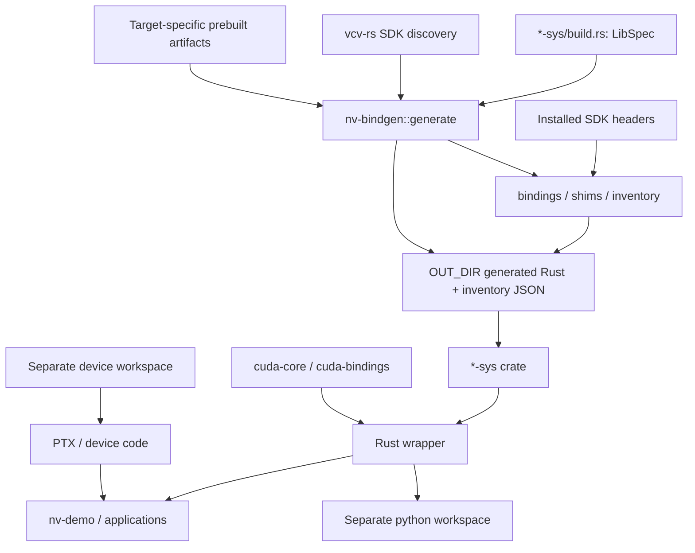
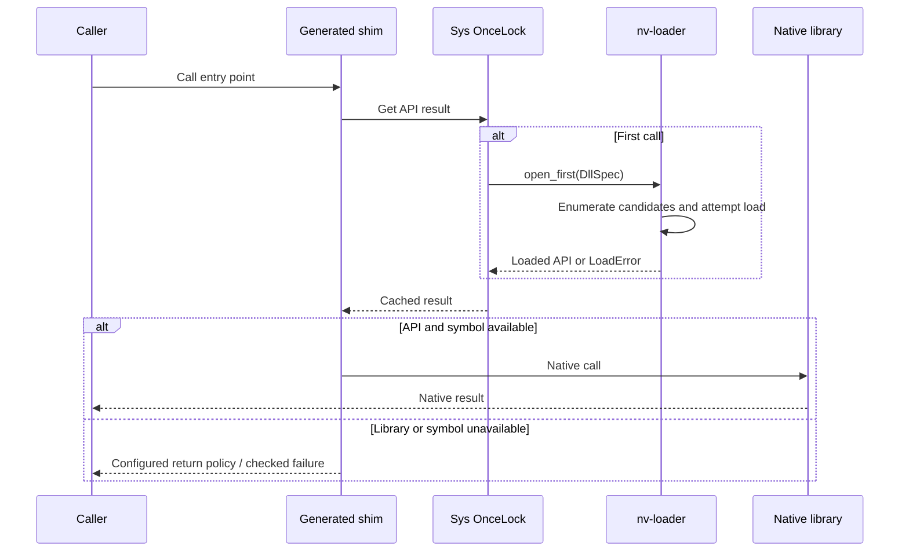
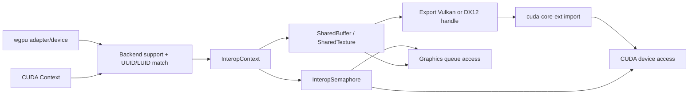
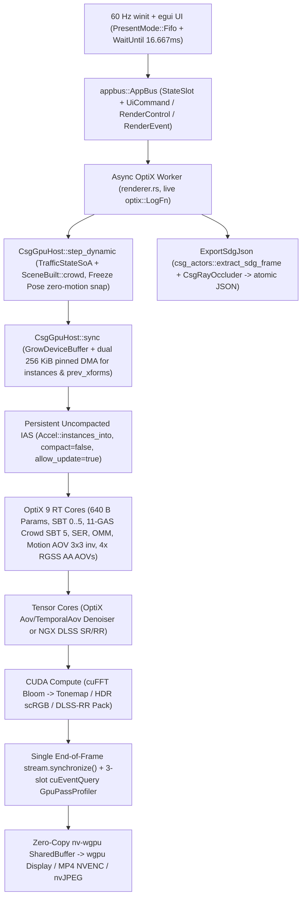

# Architecture and runtime flows

Source map verified on 2026-11-23 (`5a58bab`, `csg-rs` `539f244`). See [repository guidance](AGENTS.md), [crate codepaths](crates/AGENTS.md), and [bughunt & acceleration plan](plan1.md).

## Build architecture

Prebuilt fallback depends on matching artifacts. Static-link shapes still require native link inputs; normal export shapes load libraries at runtime.

## First call and cached failures

The shared macros retain a failed initialization for the process lifetime. Configure search paths before the first call.

## Graphics and CUDA interop

External memory shares storage. Timeline synchronization controls when either API may access it; sharing alone does not order work.

## `nv-demo` decoupled 60 Hz UI, RTX burst & SDG pipeline

The render worker submits `[IAS/Traffic/Crowd] -> [RT] -> [Denoiser] -> [cuFFT] -> [Tonemap]` in one uninterrupted stream burst with a single end-of-frame fence while `Runner::about_to_wait` paces UI redraws to 60 Hz.

## `nv-demo` audited hot-path bottlenecks vs target zero-stall architecture (`plan1.md`)

```mermaid
flowchart TD
  subgraph Current["Current Hot-Path Bottlenecks (Audited 2026-11-23)"]
    C1["TrafficOnly CPU Repack (10k-100k static + dynamic)"] --> C2["cuda_crowd Mid-Frame D2H + stream.synchronize()"]
    C2 --> C3["Accidental 50k IAS Rebuild (sat_angle when !show_classic)"]
    C3 --> C4["1 Giant AABB per PURE_UNION GAS -> SM Linear Scan + 4.2 KiB .local Spill"]
    C4 --> C5["Full-Res PoT cuFFT Bloom (2048^2 / 4096^2, ~302 MiB @ 4K)"]
    C5 --> C6["UI Thread Sync I/O (PNG/JPEG/MP4/persist) + FullWindow Poll Stall"]
  end

  subgraph Target["Target Zero-Stall Accelerated Pipeline (Waves 1-3)"]
    T1["Static-Tail Split (Repack Only [0..D] Dynamic Prefix)"] --> T2["100% GPU Crowd Steering + 1-Word Async Atomic Flag"]
    T2 --> T3["Guarded IAS State + Uncompacted Custom GAS (0 Compaction Stalls)"]
    T3 --> T4["Multi-AABB PURE_UNION GAS (RT Core BVH) + 0-Spill Registers + Shadow SBT + SER mat_id"]
    T4 --> T5["Half-Res 7-Smooth cuFFT Bloom + Pre-Normalized PSF + AOV Early-Out"]
    T5 --> T6["Async Export Worker + Disk PTX / Nvjpeg / SceneBuilt LRU Caches"]
  end
```

