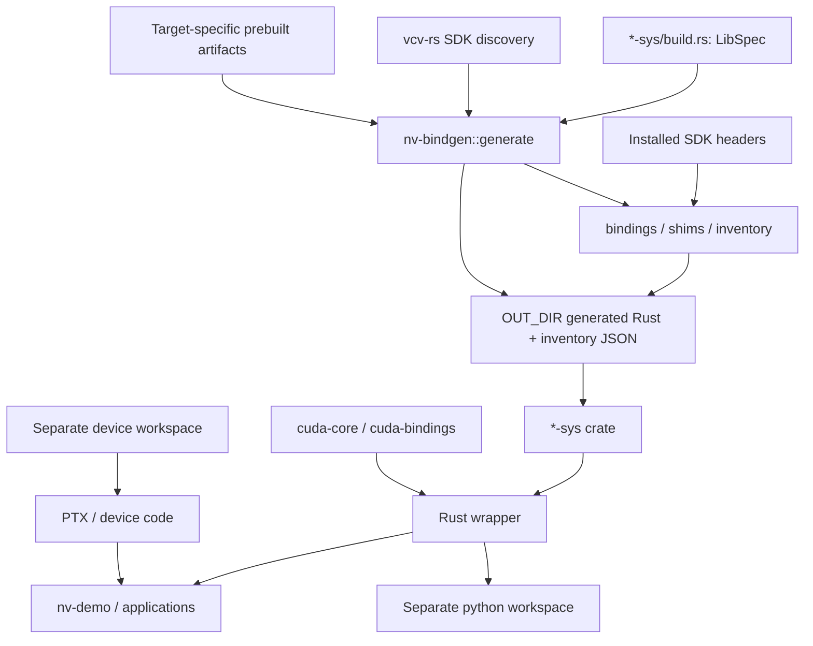
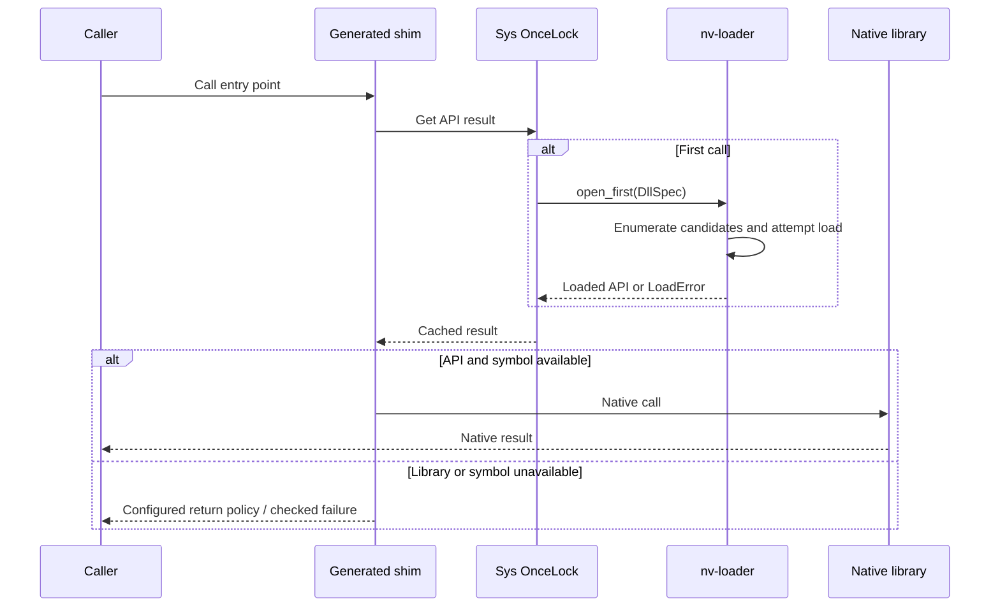
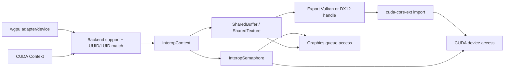

# Architecture and runtime flows

Source map verified on 2026-11-15. See [repository guidance](AGENTS.md) and [crate codepaths](crates/AGENTS.md).

## Build architecture

Prebuilt fallback depends on matching artifacts. Static-link shapes still require native link inputs; normal export shapes load libraries at runtime.

## First call and cached failures

The shared macros retain a failed initialization for the process lifetime. Configure search paths before the first call.

## Graphics and CUDA interop

External memory shares storage. Timeline synchronization controls when either API may access it; sharing alone does not order work.
